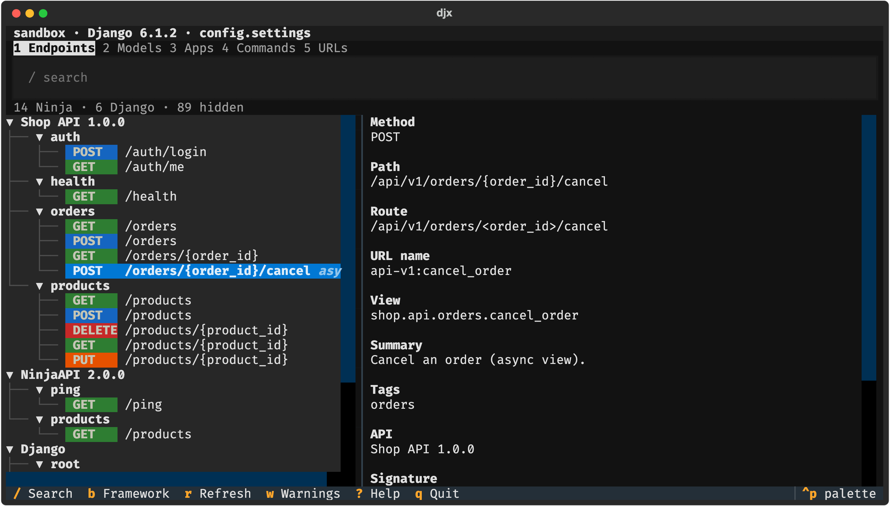
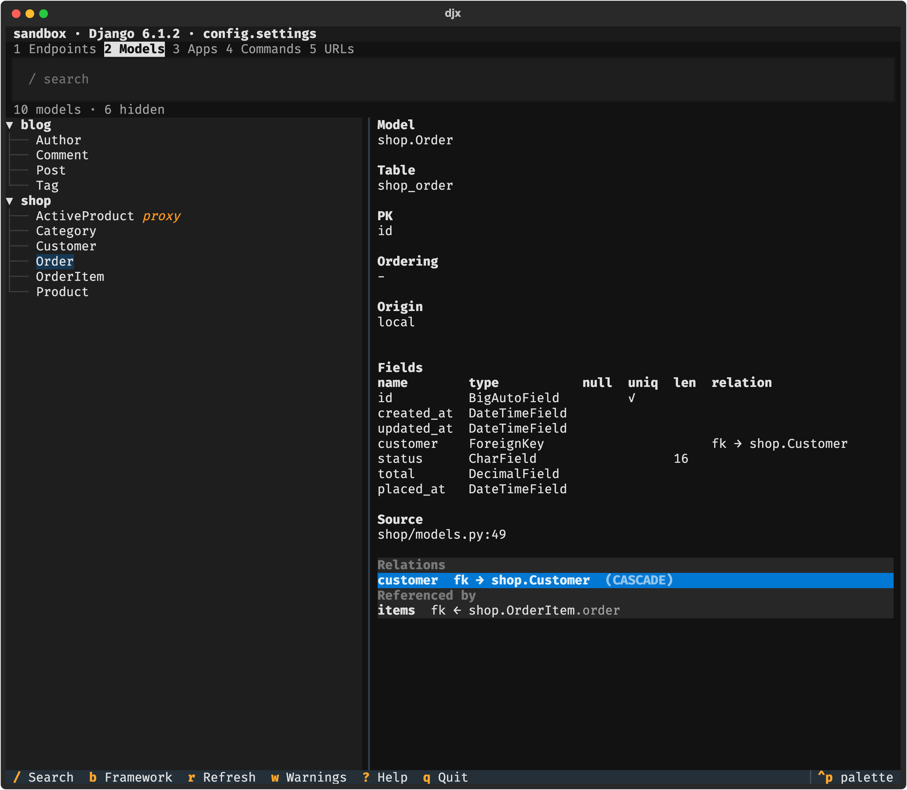
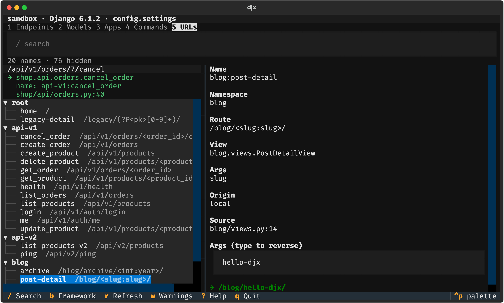
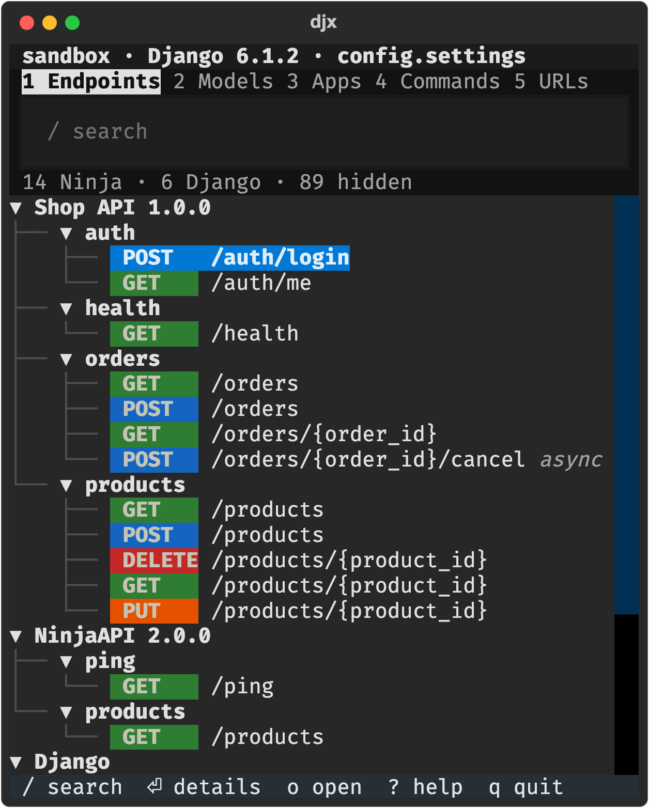
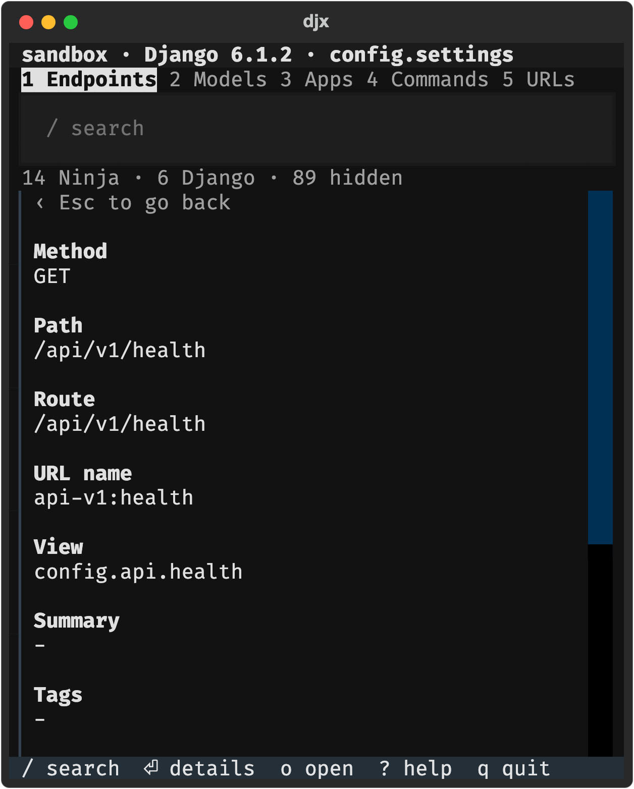

<h1 align="center">djx</h1>

<p align="center">
  <b>See your whole Django + Django Ninja project in the terminal, and jump to the code in Zed.</b><br>
  Endpoints, models, apps, commands and URL names, read from the <i>running</i> Django, not guessed from source.
</p>

<p align="center">
  <a href="https://github.com/Carnage725/djx/releases"></a>
  
  
  
  <a href="LICENSE"></a>
</p>

<p align="center">
  
</p>

## Why

"Where is that endpoint defined?" "Which models point at `Order`?" "What does `reverse('blog:post-detail', slug='x')` give?" You normally answer these by grepping, reading `urls.py` files, or running `show_urls` and `shell`. djx asks Django itself and puts the answers in one keyboard-driven screen. Press `o` and the file opens at the right line.

- **Always correct.** The data comes from Django's URL resolver and app registry, so decorators, `include()`s, class-based views and Ninja routers all resolve the way they do at runtime.
- **Ninja aware.** Every Django Ninja operation shows up with its method, path, summary, tags, signature and `async` flag, grouped by API.
- **Read-only and safe.** djx never writes to your project and never opens a database connection.
- **Fits a side panel.** It is fully usable at 50 columns, so it works docked next to your code in Zed.

## What you get

<table>
  <tr>
    <td width="50%"></td>
    <td width="50%"></td>
  </tr>
  <tr>
    <td><b>Models.</b> Fields, relations and "referenced by". Press Enter on a relation to follow it, Backspace to come back.</td>
    <td><b>URLs.</b> Type arguments and watch the path appear. Type a path and see which view handles it.</td>
  </tr>
</table>

- **Endpoints**: Django URLs and every Ninja operation, grouped by API and path. Framework noise (admin, Ninja's own docs URLs) is hidden until you press `b`.
- **Apps** and **Commands**: your code first, Django's built-ins one key away.
- **Search everywhere**: type to filter; several words must all match (`delete products`).
- **Jump to code**: `o` opens the selected endpoint, model, command or app in Zed (or VS Code, or any editor). Class-based views open the class; decorated views open the real function, not the decorator.
- **`djx doctor`**: a checklist that tells you exactly how to fix a wrong Python, missing settings or a missing editor.

<p align="center">
  
  &nbsp;&nbsp;
  <br>
  <i>The same app at 50 columns: one pane, Enter drills in, Esc goes back.</i>
</p>

## Install

Needs Python 3.12+ for djx itself. Your project can use its own Python and venv.

```sh
uv tool install git+https://github.com/Carnage725/djx
# or: pipx install git+https://github.com/Carnage725/djx
```

From a clone: `uv tool install .` (or `uv sync` and `uv run djx` while developing).

## Quick start

```sh
cd path/to/your/django/project   # the folder with manage.py (a parent folder works too)
djx doctor                       # checks your setup, tells you how to fix problems
djx                              # opens the explorer
```

Or pass the folder: `djx path/to/project`. To try it without a project of your own: clone this repo and run `uv run djx sandbox`.

Tested with Django 6.1 and django-ninja 1.7.

## Key bindings

Press `?` in the app for the same list.

| Key | What it does |
|---|---|
| `1`-`5` | Endpoints, Models, Apps, Commands, URLs |
| `Tab` / `Shift-Tab` | Next / previous section |
| `/` | Search (filters as you type) |
| `Esc` | Clear search, leave a form or list, go back |
| `j` `k` / arrows | Move |
| `Enter` | Wide terminal: open in editor. Narrow terminal: show details (then Enter opens). |
| `o` | Open the selected item in your editor (always) |
| `b` | Show / hide framework items (Django built-ins, Ninja docs URLs, admin) |
| `l` / `→` | Models, Apps: focus the relation / model list. URLs: focus the args form |
| `Enter` on a relation | Go to that model |
| `Backspace` | Back after following a link |
| `p` | URLs: resolve a path |
| `r` | Refresh (re-runs the engine) |
| `w` | Warnings from the engine |
| `?` | Help |
| `q` | Quit |

With a window 100 columns or wider you get two panes (list and details). Narrower, you get one pane.

## Use with Zed

1. **Dock the terminal on the left.** In Zed's `settings.json`:

   ```json
   {
     "terminal": {
       "dock": "left"
     }
   }
   ```

2. **Add a task** that starts djx in a new terminal tab, in your project's `.zed/tasks.json` (or `~/.config/zed/tasks.json` for every project):

   ```json
   [
     {
       "label": "djx",
       "command": "djx",
       "use_new_terminal": true,
       "allow_concurrent_runs": true,
       "reveal": "always"
     }
   ]
   ```

   Run it with the `task: spawn` action. It runs in the project root.

3. **Add a keybinding** in `keymap.json`:

   ```json
   [
     {
       "context": "Workspace",
       "bindings": {
         "alt-d": ["task::Spawn", { "task_name": "djx" }]
       }
     }
   ]
   ```

4. **Make `o` open Zed.** In Zed run `cli: install cli` from the command palette. djx then finds `zed` by itself. Without the `zed` command, set `DJX_EDITOR` (macOS example):

   ```sh
   export DJX_EDITOR="/Applications/Zed.app/Contents/MacOS/cli {file}:{line}"
   ```

5. **Tip:** paths such as `shop/api/products.py:42` that djx prints can be opened from Zed's terminal with Cmd+Click (macOS) or Ctrl+Click (Linux/Windows).

## Which Python does djx use?

djx runs its engine with **your project's Python**, because that is where Django lives. It picks the first of:

1. `--python PATH`
2. the `DJX_PYTHON` environment variable
3. a `.venv` folder in the project folder or in any parent folder
4. `$VIRTUAL_ENV`
5. the Python djx itself runs on (usually has no Django, so `djx doctor` will tell you)

## Configuration

| Flag | Environment variable | Meaning |
|---|---|---|
| `--python PATH` | `DJX_PYTHON` | Python of the project |
| `--settings MODULE` | `DJANGO_SETTINGS_MODULE` | Settings module. Default: read from `manage.py`. |
| `--editor TEMPLATE` | `DJX_EDITOR` | Editor command; `{file}` `{line}` `{col}` are filled in |
| `--json` | | Print the raw engine JSON and exit |
| `--version` | | Print the version |

Editor templates: `zed {file}:{line}`, `code -g {file}:{line}`, `nvim +{line} {file}`. Without a flag or variable djx looks for `zed`, `zeditor`, `code`, then `$EDITOR`. Editors are started detached, so use a graphical editor.

## Troubleshooting

Run `djx doctor` first. Every `[FAIL]` line has a `fix:` line.

| Problem | What `djx doctor` says | Fix |
|---|---|---|
| Not in a project | `[FAIL] Project root: no manage.py in ... or any parent folder` | `cd` into the project or run `djx path/to/project` |
| Django is not in the Python djx chose | `[FAIL] Engine: ModuleNotFoundError: No module named 'django'` and `fix: Django is not importable from <python>. Point djx at the project's Python` | Activate the project's venv, or use `--python` / `DJX_PYTHON` |
| Settings module not found | `[FAIL] Settings module: Could not determine DJANGO_SETTINGS_MODULE.` | Pass `--settings`, or set `DJANGO_SETTINGS_MODULE` |
| Settings fail to import | `[FAIL] Engine: ... fix: Could not import settings module <name>` | Fix the import error shown; `djx --json` has the full traceback |
| Nothing opens when you press `o` | `[warn] Editor: none found` | Set `DJX_EDITOR` or pass `--editor` |

If the engine takes longer than 30 seconds, djx stops it and shows an `EngineTimeout` error: something in the project hangs when imported.

## How it works

djx is two Python packages.

- **`djx_engine`** runs inside **your project's Python** as a subprocess. It starts Django, asks the real URL resolver, app registry and management registry what exists, and prints exactly one JSON document to stdout. It uses only the standard library plus your Django. It never parses your source to find routes, never opens a database connection and never writes to your project. The JSON contract is in [docs/engine-contract.md](docs/engine-contract.md).
- **`djx`** is the [Textual](https://textual.textualize.io) UI. It never imports Django: it runs the engine in a background worker and reads the JSON, so the screen stays responsive while a project loads.

Django Ninja has no public way to list the operations behind a URL, so the engine reads a few Ninja internals (`collectors/ninja_introspect.py`). It cross-checks the count against Ninja's own OpenAPI schema and warns if they disagree, and a canary test fails when a Ninja upgrade changes them.

## Development

```sh
uv sync
uv run pytest
uv run ruff check .
uv run python scripts/regen_fixture.py   # after changing the engine output
uv run python scripts/screenshots.py     # re-render the README screenshots
```

`sandbox/` is a sample Django + Ninja project full of edge cases; see [its README](sandbox/README.md). The roadmap beyond this read-only explorer (running the server and tests, trying endpoints) is not started.

## License

[MIT](LICENSE)
